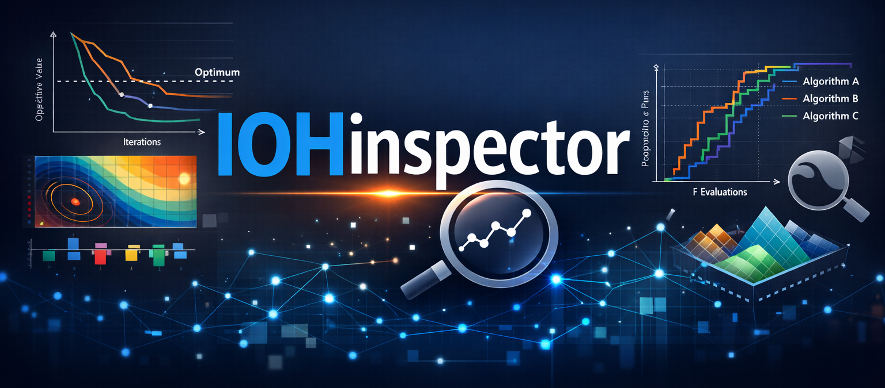
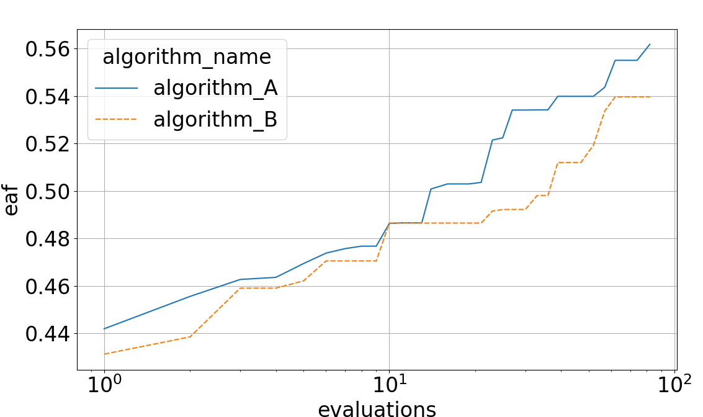

<p align="center">
  
</p>
<hr>

[](https://github.com/IOHprofiler/IOHinspector/actions/workflows/test.yml)
[](https://app.codacy.com/gh/IOHprofiler/IOHinspector/dashboard?utm_source=gh&utm_medium=referral&utm_content=&utm_campaign=Badge_grade)
[](https://app.codacy.com/gh/IOHprofiler/IOHinspector/dashboard?utm_source=gh&utm_medium=referral&utm_content=&utm_campaign=Badge_coverage)


**IOHinspector** is a Python package designed for processing, analyzing, and visualizing benchmark data from iterative optimization heuristics (IOHs). Whether you're working with single-objective or multi-objective optimization problems, IOHinspector provides a collection of tools to gain insights into algorithm performance. 

IOHinspector is a work-in-progress, and as such some features might be incomplete or have their call signatures changed or expanded when new updates release. As part of the IOHprofiler framework, our aim is to achieve feature parity with the [IOHanalyzer web-version](https://iohanalyzer.liacs.nl/). Additionally, this package serves as the basis for large-scale data processing, which is currently unspported on the web version.

## Features

- **Data Processing**: Efficient import and processing of benchmark data from [IOHexperimenter](https://github.com/IOHprofiler/IOHexperimenter), COCO, Nevergrad and CSV files (with a column mapping). Data is read into one model of four tables (runs, descriptors, trace and positions), which can also be stored as Parquet with `iohinspector convert`. By utilizing polars and this split, large sets of data can be handled efficiently.  
- **Analysis**: Perform in-depth analyses of single- and multi-objective optimization results. For the multi-objective scenario, a variety of performance indicators are supported (hypervolume, igd+, R2, epsilon), each with the option to flexibly change reference points/set as required. 
- **Visualization**: Create informative plots to better understand the optimization process. This included standard fixed-budget and fixed-target plots, EAF and ECDF visualization and more. 

## Installation

The minamal suported Python version is 3.10. Install IOHinspector via pip:

```bash
pip install iohinspector
```

## Basic usage
The basic usage of the framework is through the data manager object. A simple example is given below. This assumes that a folder created via the [IOHexperimenter](https://github.com/IOHprofiler/IOHexperimenter) called `test_data` exists and contains profiling data. This can be generated via the file [generate_test_data.py](tests%20generate_test_data.py) in the tests folder.

```python
import os
from iohinspector import DataManager, plot_ecdf

# Creating a data manager
manager = DataManager()
data_folders = [os.path.join('test_data', x) for x in os.listdir('test_data')]
manager.add_folders(data_folders)

# Loading & selecting data 
selection = manager.select(function_ids=[1], algorithms=['algorithm_A', 'algorithm_B'])
df = selection.load(monotonic=True, include_meta_data=True)

# Creating an ECDF plot, one line per algorithm
plot_ecdf(df, by=["algorithm_name"])
```

`add_folder` takes a file, a folder or an archive in any supported format. Every metric and plot groups its results with `by`, a list of columns: any column of `manager.overview`, such as `algorithm_name`, `function_id` or a descriptor of the runs. Results are polars DataFrames; call `.to_pandas()` if you prefer pandas.

Upgrading from 0.0.x? See [CHANGELOG.md](CHANGELOG.md): `free_vars` is now `by`, `return_as_pandas` is gone, and runs are identified by `run_id`.



## Tutorials

To highlight the usage of IOHinspector, we have created two tutorials in the form of jupyter notebooks:
* [Single Objective Tutorial](examples/SO_Examples.ipynb)
* [Multi Objective Tutorial](examples/MO_Examples.ipynb)

## License

This project is licensed under a standard BSD-3 clause License. See the LICENSE file for details.

## Acknowledgments

This work has been estabilished as a collaboration between:
* Diederick Vermetten 
* Jeroen Rook
* Oliver L. Preuß
* Jacob de Nobel
* Carola Doerr
* Manuel López-Ibañez
* Heike Trautmann
* Thomas Bäck

## Cite us

Citation information coming soon!
